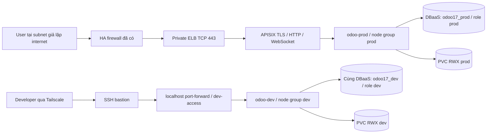

# Plan: Odoo Dev/Production trong một private CMC cluster

Ngày: 2026-10-16. Trạng thái: source GitOps đã push, app CI chuẩn bị push; chưa nghiệm thu live.

## 1. Yêu cầu đã xác nhận

- Không public IP. HA firewall đã hoạt động; firewall, route và DNS do người dùng quản lý.
- Một cluster, namespace `odoo-dev` / `odoo-prod`; hai node Dev và hai node Prod đã Ready,
  label/taint môi trường cần được xác nhận trước khi chạy deploy.
- Chung PostgreSQL DBaaS, tách database và login role; PVC/filestore/session riêng.
- Dev qua Tailscale -> SSH bastion -> localhost port-forward. Prod qua private ELB -> APISIX.
- Argo CD tiếp tục là reconciler; không apply workload trực tiếp từ CI.

## 2. Nghiên cứu trước triển khai

Đã clone và đọc README, manifest workload/gateway/network policy, Terraform EKS và
environment stacks, Argo bootstrap/Application, Kustomize overlays và pipeline promotion:

| Repo / revision | Bằng chứng và ý tưởng sử dụng |
|---|---|
| `hgiang25/hcm3-k8s-lab` main `f4d2c9484ee5784e6d81125a39774e24e09228a1` | `k8s/ingress-internal/deploy.yaml`, `ingress-private.yaml`, `ingress-public.yaml`, `ingress-nginx-svc-patch.yaml`, `network-policy.yaml`: tách entry point và network policy. Main dùng public class ở patch; không sao chép class này. |
| Cùng repo, nhánh `trinh-v2` `317c3372d88f1f8cf2346078a245a09619bc9976` | `k8s/api-gateway/deployment.yaml`, `orders-service/deployment.yaml`: nodeAffinity required với `role=app`. Đã tìm scheduling trên các branch còn lại; main không chứa taints/tolerations cho app. Mở rộng bằng ràng buộc môi trường, không giả định lab đã đủ isolation. |
| `hgiang25/aws-eks-gitops-platform` `ef26fd34d6eb8f64c263d654e2a98c93eaa86a34` | `infrastructure/modules/eks/main.tf`, environments `dev_infra` / `prod_infra`, module argocd, `.github/workflows/gitops-ci.yml`: managed groups, app repo build -> cập nhật đúng overlay. Không sao chép AWS VPC, public API, SG hay ECR annotation. |
| `hgiang25/k8s-gitops` `8a3c5f11153f48123c94cae69b11fce8faaf45b1` | `apps/dev`, `apps/prod`, `clusters/dev`, `clusters/prod`, bootstrap: base dùng chung, image pin độc lập, Dev auto-sync và Prod manual sync. Đổi destination đa cluster thành cùng API với namespace khác nhau. |

CMC xác nhận private ELB bằng `loadbalancer.openstack.org/class: cmc-loadbalancer-private`:
https://cmccloud.vn/document/Kubernetes/huong-dan/tao-service-cho-cum-k8s-voi-dich-vu-elastic-load-balancer
Scheduling semantics: https://kubernetes.io/docs/concepts/scheduling-eviction/taint-and-toleration/

## 3. Thiết kế

### Scheduling và platform

- Labels `odoo.cmc/environment=dev|prod`; taints cùng key/value, effect `NoSchedule`.
- Toleration Equal chính xác + required node affinity cho mọi Deployment, Rollout,
  init Job, backup CronJob và preflight/restore Job mới. Không wildcard toleration.
- Preferred pod anti-affinity cho web/worker replica theo hostname; topology spread
  mềm để canary surge không deadlock khi số replica lớn hơn số node.
- Dispatcher preferred pod affinity tới worker cùng namespace, không tạo dependency cứng.
- Giữ node group hiện tại cho platform (Argo CD, APISIX/etcd, Rollouts, KEDA, DNS).
  Không taint toàn bộ node hiện tại. Taint không đuổi pod cũ; kiểm tra vị trí sau rollout.
- Node group Dev tối thiểu 1 node, Prod tối thiểu 2, khuyến nghị 3; platform etcd cần
  đủ node cho anti-affinity. CNI/CSI DaemonSet phải hỗ trợ taint mới.

### Isolation / access

- Dev không có ApisixRoute, ApisixTls, NodePort hay LoadBalancer. Proxy `dev-access`
  ClusterIP route `/websocket` sang 8072, phần còn lại 8069. Port-forward chỉ bind 127.0.0.1.
- Ingress default-deny, chỉ cho đúng gateway / proxy / dispatcher / analysis.
  Đây là NetworkPolicy Kubernetes, không sửa HA firewall. CNI phải enforce policy.
- RBAC dev chỉ xem pod/service/log và port-forward pod trong Dev; không Secrets, exec, sửa pod,
  nodes hay prod. Cần bind group nhận dạng thực tế từ cơ chế auth của cluster.
- AppProject Dev/Prod chỉ cho destination tương ứng; không quản trị cluster resource.
- ResourceQuota/LimitRange giới hạn Dev và chừa surge/preflight; Prod sizing theo maxima.

### Data và connection budget

- Secret cùng tên nhưng namespace riêng; DATABASE lần lượt `odoo17_dev` / `odoo17_prod`,
  USER khác nhau; không commit host/password. Roles không superuser/createdb/createrole,
  không membership chéo; revoke CONNECT PUBLIC cho hai database và grant đúng role.
- Giữ UID/GID/fsGroup 101, RWX, queue worker HTTP-capable, cron/dispatcher no-http.
- Prod web max 8 + 20% surge (=2), worker max 4; Dev web max 2 + 1 surge, worker max 1.
  Với pool 4: Prod 180 + Dev 60 + reserve 32 = **272/300**. Kiểm tra max_connections thật;
  chừa thêm nhu cầu ngoài Odoo và không chạy legacy writers cùng Prod mới.
- S3 prefix tách môi trường; backup tiếp tục suspended tới khi S3/restore được nghiệm thu.

### GitOps và migration

- `overlays/cmc` giữ tương thích legacy; `overlays/dev` / `overlays/prod` kế thừa
  `overlays/cmc-common` không chứa image pin và pin image riêng. Sửa namespace của CRD reference, analysis URL, policy peer,
  RoleBinding và config, không chỉ metadata.namespace.
- CI app chỉ tự promote Dev; workflow Prod copy đúng image đã kiểm thử từ Dev,
  không rebuild. Prod sync thủ công theo mẫu tham chiếu.
- Giữ Application `odoo-cmc` legacy, tắt auto-sync và không cascade delete.
  Không đổi destination của Application cũ: tránh prune PVC/namespace đang chứa dữ liệu.
- Trước cutover: freeze legacy writer/scaler qua GitOps, backup/verify DB + filestore,
  copy dữ liệu sang PVC prod riêng, kiểm tra quyền UID101, chỉ sau đó sync Prod.
  Gỡ route legacy trước route Prod cùng hostname; không để hai cron/runner viết cùng DB.
- Rollback manifest bằng Git + Argo. Sau phát sinh dữ liệu/schema mới, rollback DB/file
  cần kế hoạch phục hồi; không tự bật lại legacy writers và ghi hai bộ filestore.

## 4. Thứ tự triển khai và file

1. [x] Đọc ba repo, rule hiện tại, workflow và validator; xác nhận yêu cầu DB/node groups.
2. [x] Ghi plan trước khi sửa implementation.
3. [x] Thêm overlays/dev, overlays/prod: namespace, scheduling, policy, quota, proxy Dev.
4. [x] Thêm Application/AppProject Dev/Prod; giữ legacy manual; APISIX private ELB.
5. [x] Bootstrap theo environment: secrets, DB/RWX preflight đúng node group, không
   thay cấu hình firewall. Cập nhật configure và verify workflows.
6. [x] CI Dev promotion / Prod promotion, runbook node group, DB roles, access và migration.
7. [x] Validation: renders mọi overlay, unit boundary tests, pinned Helm + CRD schemas,
   shared DB budget, no-public/no-dev-route, namespace references, scheduling mọi job.
8. [ ] Live trên bastion: node group, DB grants, RWX cross-node, private ELB, TLS,
   RBAC, network negative tests, HTTP/WebSocket, canary, KEDA và restore drill.

## 5. Acceptance và điều kiện còn thiếu

- Node/pod mapping phải đúng env; thiếu node đúng label thì Pending, không spill sang env khác.
- User subnet chỉ vào Prod; Dev chỉ qua authenticated API port-forward. Host header Dev
  trên ELB không được route vào Dev. Test Dev->Prod và Prod->Dev phải bị từ chối.
- Dev DB role không CONNECT Prod; Prod không CONNECT Dev; không chung PV/export directory.
- Một ELB private cho Prod, không floating/public IP; TLS kết thúc tại APISIX sau TCP 443.
- Test canary HTTP + WebSocket, upload/timeouts, rollout surge và shared connection budget.
- API `10.0.20.226:6443` từ workspace vẫn timeout, nhưng bastion đã truy cập lại được.
  Node groups đã tạo; chưa có bằng chứng label/taint và DB secrets từng môi trường.
  Không coi render pass là đã triển khai live.

## 6. Kết quả implementation

- Runbook thực thi: `odoo-cmc-gitops/cmc/MULTI-ENV.md` và `cmc/node-groups.example.yaml`.
- Thêm overlay `cmc-retired` để dừng legacy writers/scalers và gỡ route bằng GitOps,
  giữ PVC/namespace. Chỉ opt-in trong maintenance window; chưa chuyển live.
- 30 tests qua, gồm thử đổi tag Dev rồi render xác nhận Prod không đổi, promotion
  từ chối stale tag, private ELB fail-closed, bootstrap scheduling và namespace references.
- Actionlint qua cho hai repo; Bash syntax qua cho 22 GitOps và 8 app workflow blocks.
  GitOps commit `9204cd0` đã push; chưa chạy workflow deploy/live.
- Budget 272/300 là dự toán với workload steady/surge được cấu hình, phải đo khi vận hành.
- Bản clone ba repo tham chiếu nằm ngoài hai Git repo tại `.reference-repos/`.
