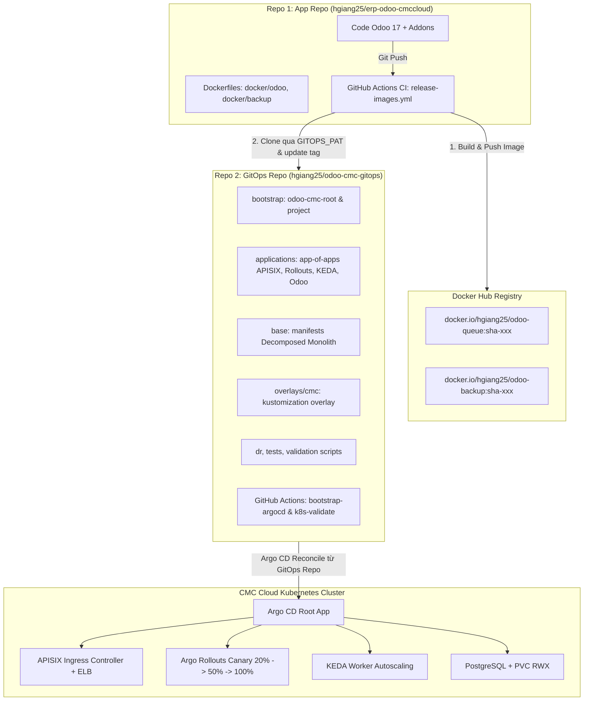

# KẾ HOẠCH PHÂN TÁCH TWO-REPOSITORY PATTERN (APP REPO & GITOPS REPO)
> **Mục tiêu**: Tách biệt hoàn toàn mã nguồn ứng dụng Odoo và cấu hình hạ tầng Kubernetes GitOps thành 2 repository riêng biệt theo chuẩn CNCF / ArgoCD Enterprise Standard, tương tự mô hình đã triển khai thành công tại `hgiang25/aws-eks-gitops-platform` và `hgiang25/k8s-gitops`.  
> **Trạng thái**: Chờ duyệt (Pending Approval)  
> **Ngày lập**: 2026-10-13

---

## 1. TỔNG QUAN KIẾN TRÚC MỚI



---

## 2. PHÂN ĐỊNH TRÁCH NHIỆM & CẤU TRÚC 2 REPO

### 2.1. Repo 1: Application Repository (`hgiang25/erp-odoo-cmccloud`)
* **Vai trò**: Dành cho Developers và Odoo Engineers. Chỉ chứa code, addons và Dockerfile.
* **Cấu trúc thư mục**:
  ```
  erp-odoo-cmccloud/
  ├── .github/workflows/
  │   └── release-images.yml     # Build images -> Push Docker Hub -> Promote sang GitOps Repo
  ├── addons/                    # Custom Odoo addons
  ├── odoo/                      # Core Odoo source code
  ├── docker/                    # Gom Dockerfile vào đây thay vì nằm trong k8s/
  │   ├── odoo/                  # Context build odoo-queue (OCA queue_job ghim commit)
  │   │   ├── Dockerfile
  │   │   └── render_config.py
  │   └── backup/                # Context build odoo-backup
  │       ├── Dockerfile
  │       ├── backup.sh
  │       └── restore.sh
  ├── docker-compose.yml         # Môi trường chạy local bằng Docker Compose
  ├── requirements.txt
  └── odoo-bin
  ```
* **GitHub Secrets cần trên Repo 1**:
  * `DOCKERHUB_USERNAME`: Username Docker Hub
  * `DOCKERHUB_TOKEN`: Access Token Docker Hub
  * `GITOPS_PAT`: Personal Access Token của GitHub (scope `repo`) để commit sang Repo 2

---

### 2.2. Repo 2: GitOps Repository (`hgiang25/odoo-cmc-gitops`)
* **Vai trò**: Single Source of Truth cho toàn bộ hạ tầng K8s và Argo CD trên CMC Cloud. Không chứa mã nguồn app.
* **Cấu trúc thư mục**:
  ```
  odoo-cmc-gitops/
  ├── .github/workflows/
  │   ├── k8s-validate.yml         # Kiểm tra schema, unittest, helm template
  │   └── bootstrap-argocd.yml     # Self-hosted runner bastion: cài Argo CD & apply root app
  ├── bootstrap/
  │   ├── odoo-cmc-project.yaml    # AppProject giới hạn namespace và repo
  │   └── odoo-cmc-root.yaml       # Application root (trỏ tới applications/)
  ├── applications/                # App-of-apps quản lý child applications
  │   ├── apisix.yaml              # APISIX Gateway Helm Chart
  │   ├── argo-rollouts.yaml       # Argo Rollouts Helm Chart
  │   ├── keda.yaml                # KEDA Autoscaler Helm Chart
  │   ├── cmc-infrastructure.yaml  # APISIX etcd
  │   ├── odoo.yaml                # Odoo Application (trỏ tới overlays/cmc)
  │   └── kustomization.yaml
  ├── base/                        # Manifests Decomposed Monolith chuẩn
  │   ├── 01-secrets-and-configmap.yaml
  │   ├── 02-storage.yaml
  │   ├── 03-postgres.yaml
  │   ├── 04-redis.yaml (stub)
  │   ├── 06-odoo-worker.yaml
  │   ├── 06-odoo-cron-and-runner.yaml
  │   ├── 07-service.yaml
  │   ├── 08-apisix-gateway.yaml
  │   ├── 09-keda-autoscaling.yaml
  │   ├── 10-argo-rollout.yaml
  │   ├── 11-backup-cronjob.yaml
  │   ├── 12-init-db.yaml
  │   └── kustomization.yaml
  ├── overlays/
  │   ├── cmc/                     # Overlay môi trường CMC Cloud
  │   │   ├── cloud-resources.yaml
  │   │   └── kustomization.yaml   # Nơi CI cập nhật tag sha-xxx
  │   ├── cmc-infrastructure/      # Overlay etcd CMC
  │   │   └── kustomization.yaml
  │   ├── local/                   # Overlay Docker Desktop local
  │   └── http-scaling/            # Overlay Prometheus scaler
  ├── dr/                          # Disaster recovery scripts (restore-drill)
  ├── tests/                       # Unit tests & offline validator
  ├── cmc.py, validate.py, requirements-tools.txt
  └── README.md                    # Tài liệu vận hành hạ tầng
  ```
* **GitHub Variables cần trên Repo 2**:
  * `CMC_KUBE_CONTEXT`: Context kubeconfig của CMC trên Bastion VM.
* **Runners trên Repo 2**:
  * Self-hosted runner trên Bastion VM (nhãn `[self-hosted, Linux, X64]`) gắn vào Repo 2 để chạy `bootstrap-argocd.yml`.

---

## 3. CÁC THAY ĐỔI CẤU HÌNH CỤ THỂ KHI CHUYỂN SANG TWO-REPO

### 3.1. Cập nhật URL trong Argo CD Manifests (Repo 2)
1. **`bootstrap/odoo-cmc-root.yaml`**:
   ```yaml
   spec:
     source:
       repoURL: https://github.com/hgiang25/odoo-cmc-gitops.git
       targetRevision: main
       path: applications
   ```
2. **`bootstrap/odoo-cmc-project.yaml`**:
   ```yaml
   spec:
     sourceRepos:
     - https://github.com/hgiang25/odoo-cmc-gitops.git
     - https://apache.github.io/apisix-helm-chart
     - https://argoproj.github.io/argo-helm
     - https://kedacore.github.io/charts
   ```
3. **`applications/odoo.yaml`**:
   ```yaml
   spec:
     source:
       repoURL: https://github.com/hgiang25/odoo-cmc-gitops.git
       targetRevision: main
       path: overlays/cmc
   ```
4. **`applications/cmc-infrastructure.yaml`**:
   ```yaml
   spec:
     source:
       repoURL: https://github.com/hgiang25/odoo-cmc-gitops.git
       targetRevision: main
       path: overlays/cmc-infrastructure
   ```

### 3.2. Cập nhật Workflow CI trong Repo 1 (`release-images.yml`)
Workflow build image trên App Repo sẽ học theo đúng cú pháp từ `gitops-ci.yml` của bạn:
```yaml
    # 1. Build & Push 2 Docker images
    - name: Build and push Odoo image
      uses: docker/build-push-action@v6
      with:
        context: docker/odoo
        push: true
        tags: docker.io/${{ secrets.DOCKERHUB_USERNAME }}/odoo-queue:${{ env.IMAGE_TAG }}

    - name: Build and push Backup image
      uses: docker/build-push-action@v6
      with:
        context: docker/backup
        push: true
        tags: docker.io/${{ secrets.DOCKERHUB_USERNAME }}/odoo-backup:${{ env.IMAGE_TAG }}

    # 2. Clone Repo GitOps
    - name: Clone GitOps Repo
      uses: actions/checkout@v4
      with:
        repository: hgiang25/odoo-cmc-gitops
        token: ${{ secrets.GITOPS_PAT }}
        path: gitops-repo

    # 3. Cập nhật image tag trong overlays/cmc
    - name: Update image tags
      run: |
        python -m pip install -r gitops-repo/requirements-tools.txt
        python gitops-repo/gitops/update_images.py \
          --username "${{ secrets.DOCKERHUB_USERNAME }}" \
          --tag "$IMAGE_TAG" \
          --target gitops-repo/overlays/cmc/kustomization.yaml

    # 4. Commit and Push sang GitOps Repo
    - name: Commit and Push to GitOps
      run: |
        cd gitops-repo
        git config user.name "github-actions[bot]"
        git config user.email "github-actions[bot]@users.noreply.github.com"
        git add overlays/cmc/kustomization.yaml
        git diff --staged --quiet || git commit -m "chore(gitops): promote Odoo images to $IMAGE_TAG"
        git push origin main
```

---

## 4. KẾ HOẠCH THỰC HIỆN TỪNG BƯỚC (STEP-BY-STEP ROADMAP)

| Bước | Hành động | Nội dung chi tiết | Bên thực hiện |
|---|---|---|---|
| **B1** | Chuẩn bị thư mục GitOps | Tổ chức toàn bộ cây thư mục K8s vào một thư mục staging sẵn sàng cho Repo 2 (`odoo-cmc-gitops`) | Agent |
| **B2** | Cập nhật cấu hình Repo 2 | Cập nhật URL trỏ về `hgiang25/odoo-cmc-gitops.git`, kiểm tra test offline `test_cmc.py` và `validate_cloud_charts.py` | Agent |
| **B3** | Tái cấu trúc App Repo | Di chuyển `k8s/image` -> `docker/odoo`, `k8s/backup` -> `docker/backup`; viết lại `release-images.yml` hỗ trợ `GITOPS_PAT` | Agent |
| **B4** | Tạo GitHub Repo 2 | Bạn tạo repo mới `hgiang25/odoo-cmc-gitops` trên GitHub (hoặc tên tùy bạn chọn) | Bạn |
| **B5** | Push code sang Repo 2 | Agent chuẩn bị sẵn các câu lệnh git để bạn push toàn bộ thư mục GitOps lên repo mới | Bạn / Agent |
| **B6** | Cấu hình Secrets & Runners | Tạo `GITOPS_PAT` gán vào Repo 1; tạo `CMC_KUBE_CONTEXT` và gán self-hosted runner vào Repo 2 | Bạn |
| **B7** | Dọn dẹp & Xác minh | Xóa thư mục `k8s/` khỏi App Repo sau khi Repo 2 đã hoạt động độc lập, xác minh smoke test | Agent & Bạn |

---

## 5. CÂU HỎI LÀM RÕ TRƯỚC KHI BẮT ĐẦU (USER CONFIRMATION)
1. Bạn dự định đặt tên repository GitOps mới là gì? (`hgiang25/odoo-cmc-gitops` hay `hgiang25/odoo-gitops`?)
2. Bạn có muốn giữ lại thư mục `docker-compose.yml` và dev local trong App Repo không? (Khuyến nghị: Có, để dev test nhanh).
3. Sau khi tôi chuẩn bị xong toàn bộ cấu trúc và script, bạn có sẵn sàng tạo Personal Access Token (`GITOPS_PAT`) với quyền `repo` trên GitHub không?
